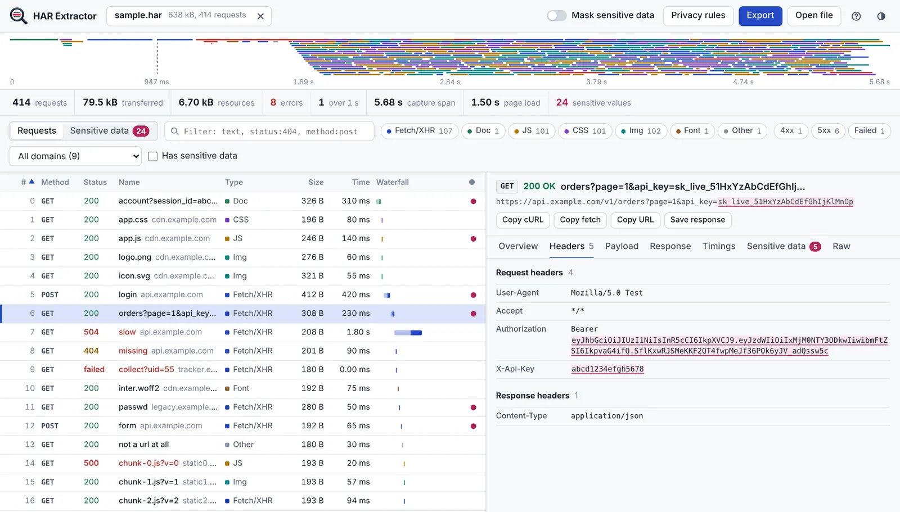

  <picture>
    <source media="(prefers-color-scheme: dark)" srcset="assets/logo-dark.png">
    
  </picture>

# HAR Extractor

**Read, clean and export HAR files, entirely in your browser.**

HAR Extractor opens the `.har` network recordings that browsers save from their developer tools.
It lists every request, highlights passwords, tokens and other secrets inside them, and exports
clean copies that are safe to send to a customer, a colleague or a support team.

It is a single HTML file. There is nothing to install, no account, no server, and the page is built
so that it cannot connect to the internet at all.

## Get it

1. Download [`har-extractor.html`](har-extractor.html) and [`user-guide.html`](user-guide.html) from the
   [latest release](../../releases/latest). You can also open either file above and use the
   **Download raw file** button.
2. Keep both files in the same folder.
3. Double-click `har-extractor.html`. It runs in current Chrome, Edge, Firefox, Safari, Brave and Vivaldi.

The user guide explains every feature with screenshots. GitHub shows HTML files as code rather than as
pages, so download it and open it in your browser.

## What it does

**Read**
- Request table with sorting, type and status chips, domain and page filters, and a search syntax:
  `status:5`, `method:post`, `domain:api`, `slower:1000`, `larger:500k`, `-analytics`
- A timeline of the whole capture: drag across it to focus on a moment, click a bar to open that request
- Detail tabs for overview, headers, payload, response, cookies, timings, sensitive data and the raw entry
- Formatted JSON, image previews, a hex view for binary files, and readable timing breakdowns
- Copy any request as a cURL command, a JavaScript `fetch` call or a URL
- Handles large captures: tested with 20,000 requests in a 97 MB file

**Find secrets**
- Scans addresses, headers, cookies, form fields and bodies, including base64-encoded bodies
- Detects passwords, session cookies, JSON Web Tokens, Bearer and Basic credentials, credentials in URLs,
  private keys, API keys (AWS, Google, GitHub, GitLab, Stripe, Slack, SendGrid, npm, Shopify and `sk-` keys),
  card numbers (Luhn-checked), email addresses and, optionally, IPv4 addresses
- Your own rules, as exact text or regular expressions, with a live tester

**Redact**
- Highlights every finding; **Mask sensitive data** replaces them on screen and in copies
- Choose the label: `[REDACTED]`, `[SENSITIVE DATA]` or your own, optionally tagged as `[REDACTED:jwt]`
- Keeps structure readable: cookie names and auth schemes stay, as in `Bearer [REDACTED]`

**Export**
- Diagnostic report in Markdown, plain text or JSON, ready for tickets, email or AI assistants
- Sanitised HAR that opens in any browser's developer tools
- Sensitive data list in Markdown, text, JSON or CSV
- Request table as CSV, protected against spreadsheet formula injection
- ZIP of every captured response body, with a manifest
- Each export can cover all requests, the filtered requests or the selected request

## Privacy and security

- **Local only.** Files are read by the page in your browser and never uploaded.
- **No network access.** A Content Security Policy with `connect-src 'none'` blocks every connection.
- **Nothing from a capture can run.** All captured data is displayed as text. The CSP is pinned to
  SHA-256 hashes of the app's own script and stylesheet, so no other code can execute, and there are no
  inline event handlers, no `eval` and no `innerHTML`.
- **No third-party code.** ZIP files are built with the browser's native `CompressionStream`.
- **Defensive exports.** ZIP paths cannot escape their folder; CSV cells cannot trigger formulas.

Automatic detection catches the common kinds of secret, but no tool can know every format a site uses.
Review exports before sharing them.

## Reporting problems

Please [open an issue](../../issues). Never attach a real HAR file: it may contain someone's passwords or
session cookies. If you need to share one, export a sanitised HAR first and check it.

To report a security problem privately, see [SECURITY.md](SECURITY.md).

## Credits

Inspired by [harextract](https://github.com/JC3/harextract) by Jason Cipriani. HAR Extractor 1.0 and
later is a complete rewrite and contains none of its code.

## Licence

Copyright (c) 2026 Gautam

Released under the [MIT License](LICENSE): you are free to use, copy, modify, merge, publish, distribute,
sublicense and sell copies of HAR Extractor, provided the copyright notice and the licence text are
included. It is provided "as is", **without warranty of any kind**.
